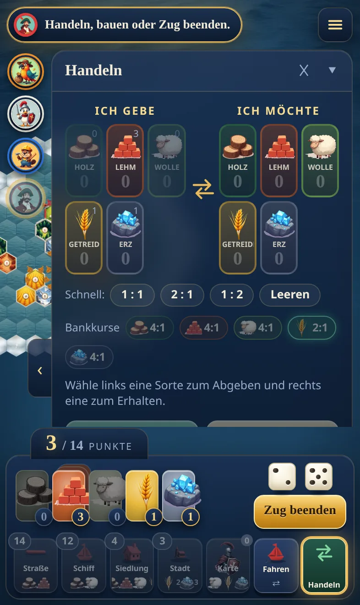
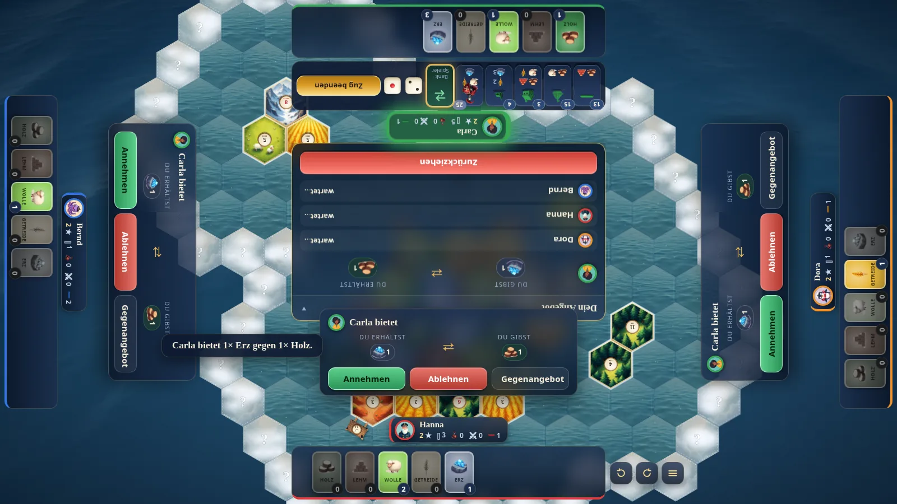

# Die Handelsinseln – Brettspiel im Browser

Mehrspieler-Brettspiel im Browser für 2–6 Spieler (standardmäßig 14 Siegpunkte): Siedlungen, Städte und Straßen bauen, mit Schiffen
unbekannte Inseln im Nebel entdecken, Gold schürfen, handeln. Die gesamte Spiellogik läuft im Server (Node, keine Laufzeit-Abhängigkeiten,
als Podman-Container); die Mitspieler öffnen nur die Webseite, geben Namen, Farbe und Avatar an und spielen – am PC, am Tablet, am Handy
oder gemeinsam an einem **digitalen Spieltisch**.

- Vier Spielfeld-Varianten, zufällige und unbegrenzt entdeckbare Karte, Piraten, Goldfelder, Häfen.
- Bots mit Persönlichkeit, Auto-Modus für Abwesende, Übernahme verlassener Spieler.
- Sprachchat (WebRTC), Chat, Zuschauer, Statistik nach Spielende.
- Installierbar als App (PWA) auf Android und iPhone.

## Screenshots

Echte Partien (Sicht von Anna, dazu die drei Bots), je Variante ein eigenes Spiel:

| Klassisch, Handel offen | Nebelinseln |
|---|---|
|  |  |
| **Vier Heimatinseln** | **Archipel** |
|  |  |


### iPhone

Dieselbe Partie auf einem iPhone (hochkant): kompakte Spielerleiste mit Avataren, Kartenleiste mit allen fünf Rohstoffen, Bauknöpfe
darunter; Handelsfenster und Spielmenü (u. a. „Karte links/rechts drehen“, „Brett zentrieren“) legen sich über die Karte. Quer gehalten
liegen Rohstoffe, Bauknöpfe, Würfel und „Zug beenden“ in einer Zeile.

| Spiel | Handeln | Spielmenü |
|---|---|---|
|  |  |  |


### Anmeldung und Lobby

| Anmeldung mit Avatar-Auswahl | Lobby mit Bots |
|---|---|
|  |  |


### Digitaler Spieltisch

Der Browser des Spielleiters wird zur Tischplatte, die Spielerleisten sitzen gedreht an allen Rändern; beim Start wählt jeder Tischspieler
seinen Platz, Handelsangebote erscheinen an der Leiste jedes Spielers:


| Platzwahl beim Spielstart | Handelsangebot am Tisch |
|---|---|
|  |  |

### Karten

Die Karten sind mit Flux/Forge gemalt: Rohstoffe, Ereigniskarten (Entwicklungskarten) und die Kartenleiste im Spiel.


Kartenanimation (eine Karte fliegt vom Feld in die eigene Hand):


**Neu erzeugen:** Spielansichten, Statistik, Kartenleiste und iPhone-Ansichten mit `node tests/mock/readme.js && node tests/mock/serve.js &` und dann
`python3 tests/mock/readme_shots.py` (iPhone 15 emuliert: Touch, iOS-Kennung; Anmeldung: `?mock=anmeldung`); Lobby mit Bots und Spieltisch fotografieren
`tests/browser_bots.py` und `tests/browser_table.py` mit gesetztem `SHOTS=<Verzeichnis>`. Die PNGs werden mit `cwebp -q 82` nach WebP umgewandelt.

## Starten

```bash
podman build -t handelsinseln -f Containerfile .
podman run -d --name handelsinseln -p 8080:8080 -p 8443:8443 -v handelsinseln-data:/data handelsinseln
# Browser: http://<rechner>:8080
```

Dauerbetrieb mit systemd-Quadlet: Vorlage `deploy/handelsinseln.container` (Image `localhost/handelsinseln`, Volume `handelsinseln`, TLS übernimmt ein
Reverse-Proxy, daher `HTTPS_PORT=0`).
Neue Version auf einen anderen Rechner ausrollen: `podman build -t localhost/handelsinseln:latest . && podman save localhost/handelsinseln:latest | ssh <host> podman load && ssh <host> systemctl restart handelsinseln.service`.

**Release:** Die Version steht in `package.json`. Neue Funktionen kommen in `CHANGELOG.md` unter „Unveröffentlicht“. Zum Veröffentlichen auf `master`:
`./scripts/release.sh 1.0.0 --build` (oder `npm run release -- 1.0.0`) – prüft Branch und sauberen Arbeitsbaum, führt `tests/run_all.sh` aus, setzt Version und CHANGELOG-Abschnitt,
committet „Release 1.0.0“, setzt das Tag `v1.0.0` und baut mit `--build` das Image `localhost/handelsinseln:1.0.0` (+ `latest`). Gepusht wird nie automatisch; das Skript nennt die nächsten Befehle.
`--schnell` führt nur die Node-Tests aus (wenn die CI den Commit schon voll geprüft hat), `--skip-tests` gar keine. Ein gepushtes Tag `vX.Y.Z` legt auf GitHub automatisch ein Release mit dem CHANGELOG-Abschnitt an (`.github/workflows/release.yml`).

Lokal ohne Container: `node server/server.js`. Zum Entwickeln: `npm run dev` (Port 8090, nur http, Spielstand in `/tmp/handelsinseln-dev`, Neustart des Servers bei Änderungen;
Änderungen in `public/` genügt ein Neuladen im Browser, ggf. „Bypass for network“ für den Service Worker). Umgebungsvariablen: `PORT`, `DATA_DIR` (Spielstand), `ABSENT_MS` (Abwesenheit bis Auto-Modus, 60000),
`LISTEN` (Adresse:Port des http-Listeners, z. B. `127.0.0.1:8080`; sonst `PORT`), `MAX_GAMES` (gleichzeitige Spiele, 3), `BOT_MS` (Takt der Bots, 800), `TICK_MS` (Takt der Zeitprüfung, 2000), `GRACE_MS` (Kulanz, bis ein Spiel ohne verbundenen Menschen endet, 20000), `HTTPS_PORT` (8443), `TLS_CERT`/`TLS_KEY`/`TLS_HOSTS`, `STUN_URL` (optional, für Sprachchat über Netzgrenzen).

**Sprachchat und https:** Browser erlauben das Mikrofon nur unter `https://` oder `http://localhost`. Der Server startet deshalb zusätzlich auf Port 8443 mit https und
erzeugt dafür selbst ein Zertifikat (gespeichert in `DATA_DIR/tls`). Beim ersten Öffnen von `https://<rechner>:8443` muss der Browser-Warnhinweis einmal bestätigt werden
(selbstsigniert); danach meldet man sich dort an. Die Lobby verweist bei `http://` automatisch darauf. Ports: `podman run … -p 8080:8080 -p 8443:8443 …`.
Weitere Namen/IPs für das Zertifikat: `TLS_HOSTS=handelsinseln.lan,192.168.0.20`; eigenes Zertifikat: `TLS_CERT`/`TLS_KEY`; https abschalten: `HTTPS_PORT=0`.
Stummschalten ist immer möglich (Knopf im Spiel und im Menü, optional Push-to-talk mit Leertaste); bei Echo Kopfhörer nutzen.

## Handy und iPhone

- **Kompakte Ansicht:** Auf Handys (hochkant und quer) zeigt die Spielerleiste nur die Avatare, das Protokoll liegt als Schublade am rechten Rand
  (‹), die Kartenleiste unten zeigt immer alle fünf Rohstoffe vollständig; nur die Entwicklungskarten daneben lassen sich wischen. Die
  Handlimit-Warnung erscheint als kleines Etikett über den Rohstoffen.
- **Bestätigung auf der Karte:** Bei Bedienung per Finger führt ein Tipp auf ein Ziel (Bauen, Aufbau, Räuber/Pirat, Schiff versetzen, Übernahme)
  nicht sofort aus; das Ziel wird markiert und erst „Siedlung bauen“, „Räuber hierher“ usw. bestätigt. Mit der Maus und am Spieltisch genügt ein Klick.
- **Karte bewegen:** Verschieben mit einem Finger, Zoomen mit zwei Fingern. Die Karte zentriert sich nicht von selbst, sondern per Doppeltipp oder
  „Brett zentrieren“ im Menü. Drehen in 60°-Schritten über „Karte links/rechts drehen“ im Hamburger-Menü (frei mit zwei Fingern nur am Spieltisch).
- **iPhone (Safari):** Die Leisten berücksichtigen Notch und Home-Balken (Safe Area); das Handelsfenster endet über der unteren Leiste und scrollt;
  die Würfel zeigen nach dem Wurf eine flache Seite (Safari stellt die 3D-Würfel in der Leiste nicht zuverlässig dar). Vibration, wenn man in der
  Controller-Ansicht am Zug ist, gibt es nur dort, wo der Browser sie erlaubt (Android, nicht iOS).
- **Als App:** Über „Zum Home-Bildschirm“ (iPhone, Teilen-Menü in Safari) bzw. „App installieren“ (Android/Chrome) läuft das Spiel als
  eigenständige App ohne Adressleiste (Manifest, Icons inkl. Apple-Touch-Icon und Service Worker in `public/`; braucht https).
- Töne lassen sich im Spielmenü abschalten.

## Spiele, Lobby, Einstellungen

- Wer den Server betritt, sieht alle beitretbaren Spiele; gibt es keins, eröffnet er ein neues und wird Spielleiter. Beliebig viele Spiele laufen parallel.
- Eine Seitenleiste („Regeln“) listet alle vom Standard abweichenden Einstellungen – in der Lobby und im Spiel.
- Der Spielleiter kann Mitspieler entfernen, die Plätze als „fertig besetzt“ erklären, das Spielfeld vorab ansehen und neu würfeln (die Karten werden auf ausgeglichene Startecken geprüft)
  und wählt die **Variante**: *Klassisch* (Hauptinsel, kleine Inseln, Nebel), *Nebelinseln* (kleine Startinsel, alles muss entdeckt werden),
  *Vier Heimatinseln* (jeder startet auf einer eigenen Insel), *Archipel* (viele kleine Inseln, viel Gold, viele Häfen). Alle in der Lobby sehen die Auswahl live und können per Chat oder Sprache mitreden.
- **Digitaler Spieltisch:** Der Browser des Spielleiters (z. B. ein in den Tisch eingelassener Bildschirm) wird zur Tischplatte, sobald er in der Lobby einen **Tischspieler** anlegt („Tischspieler anlegen …“: Name, Farbe, Avatar). Alle Spieler sitzen dann am Tisch – Bots und Online-Spieler (am eigenen Gerät) lassen sich dazu mischen: Sie sitzen am Tisch nur mit öffentlicher Leiste (ohne geheimen Bereich) und handeln selbst bzw. automatisch; ihre Aktionen am Spielfeld gibt der Online-Spieler am Handy frei (Controller-Ansicht), der Spieltisch zeigt die Ziele. Das Spielfeld füllt den Bildschirm (alle Nicht-Nebel-Felder gerade noch sichtbar), jede Spielerleiste sitzt dauerhaft am Rand zur Sitzposition gedreht (auch mit geheimen Karten – die Spieler decken sie ab), Menüs und Handelsangebote erscheinen an der jeweiligen Leiste. Beim Start wird jeder Tischspieler der Reihe nach (Spielleiter zuerst) gefragt, wo er sitzt (Online-Spieler und Bots bekommen einen freien Platz), und wählt einen der acht Plätze (an den langen Seiten je drei, an den kurzen einer). Die Reihenfolge ergibt sich aus den Plätzen im Uhrzeigersinn, gewürfelt wird nur, wer beginnt. Die Karte wird passend zum Seitenverhältnis des Bildschirms erzeugt.
- **Zuschauen:** Auf der Startseite ist ein laufendes Spiel farblich abgesetzt; wählt man es, heißt der Knopf „Spiel ansehen“. Der Browser zeigt dann die öffentliche Tisch-Anzeige (alle Spielerleisten oben links ohne Randabstand, die Würfel neben dem Spieler am Zug, Meldungen in der Spielfeldmitte) – ohne Handkarten, Entwicklungskarten, Chat und Sprachchat und ohne jede Aktion. Bis zu 8 Zuschauer je Spiel; das Menü bietet „Zuschauen beenden“.
- **Karte drehen:** ↺/↻ neben dem Menü drehen die Karte in 60°-Schritten; auf dem Handy stehen sie als „Karte links/rechts drehen“ im Hamburger-Menü. Mit zwei Fingern dreht sich die Karte nur am Spieltisch. Die Zahlenchips und Hafenschilder bleiben aufrecht; am Spieltisch folgen sie der Sicht des Tischspielers am Zug (bei Bot oder Online-Spieler: des folgenden Tischspielers).
- **Goldfluss:** In den Spieleinstellungen: Goldfluss auf der Startinsel erlaubt (nur beim Erzeugen der Karte), Erstsiedlung am Goldfluss erlaubt, maximale Ertragsrate (1–5: welche Zahlen ein Goldfeld tragen darf).
- **Version:** Liegen seit dem letzten Tag Commits vor, zeigt die Version einen Zusatz (z. B. `1.5.12+5.e51231f`; aus `git describe` oder der Umgebungsvariable `APP_VERSION`, z. B. per `--build-arg`).
- **Controller-Ansicht:** Sobald eine Tisch-Anzeige (Zuschauer) verbunden ist, schaltet das Handy von selbst in die Controller-Ansicht: Es zeigt nur noch Karten und Aktionen (Würfeln, Hand, Bauen, Handeln, Punkte) im Vollbild, das Spielfeld zeigt die Tisch-Anzeige. Das Hamburger-Menü wechselt zur „Karte“ (und zurück zu „Nur Karten & Aktionen“) und bietet bei übernommenen Plätzen „Kontrolle an den Spieltisch“. Eine Aktion am Spielfeld (Siedlung, Stadt, Straße, Schiff, Schiff versetzen, Übernahme, Räuber/Pirat, im Aufbau Siedlung und Straße/Schiff) wird erst am Handy freigegeben („Am Spieltisch wählen“); die Tisch-Anzeige zeigt dann die möglichen Ziele, jemand tippt dort eines an, und erst die Bestätigung am Handy führt die Aktion aus – so kann kein anderer für den Spieler am Zug handeln. Rückfragen (Abwerfen, Gold, Opfer wählen, Handel) bleiben am Handy. Verschwindet die Tisch-Anzeige, schaltet das Handy zurück auf die normale Ansicht.
- **Kontrolle an ein Handy übergeben:** Ein Handy, das einem Tisch-Spiel zusieht („Spiel ansehen“), drückt lange auf die Leiste eines Tischspielers oder Bots und bestätigt „Kontrolle übernehmen?“; es zeigt dann eine vierstellige Nummer. Am Spieltisch erscheint in der Leiste des Spielers ein ☰ (die ersten 3 s blinkend, die Anfrage gilt 15 s). Tippt der Tischspieler darauf, fragt der Tisch „Kontrolle abgeben?“ mit derselben Nummer – erst nach „Ja, abgeben“ übernimmt das Handy den Platz (der Spielleiter bedient den Tisch, auch für Bots); die Leiste am Tisch zeigt dann nur noch die Statistik. Ein Bot wird dabei zum Menschen und bleibt es. „Kontrolle an den Spieltisch“ im Menü des Handys beendet dessen Sitzung sofort und gibt den Platz an den Tisch zurück; ist das Handy weg, holt der Tisch den Platz über das ☰ in der Leiste zurück. Der Spielleiter-Platz lässt sich ebenfalls übergeben, die Spielleiter-Rechte bleiben am Tisch.
- **Einstellungen** (Standard = Originalregeln): **Auto Ablauf** manuell/auto (Auto: sofort nach Zugende würfeln, Hinweise blenden sich aus, Karten fliegen schnell; Manuell: Reihenfolge wird ausgewürfelt, Hinweise per Klick schließen, Karten fliegen langsam ), Inselabstand normal/weiter (Heimatinsel/Archipel; normal = dicht, weiter = größere Abstände), Räuber manuell/automatisch, Siegpunkte, Handkarten-Limit (bei einer 7), Bankkurs,
  Spielerhandel an/aus, Inselpunkte, Minima für Längster Handelsweg/Stärkste Schutzmacht und **Vorräte**: Straßen, Schiffe, Siedlungen, Städte, Entwicklungskarten
  (Standard/Zahl/unbegrenzt), Bank-Vorrat je Rohstoff, aufdeckbare Felder je Gelände und Wertechips je Zahl (jeweils Zahl oder unbegrenzt).
  Sind Vorräte des Nebels erschöpft, wird weiter Meer aufgedeckt. Im laufenden Spiel kann der Spielleiter über „Spiel ändern“ (Menü oder Statistik) alles außer dem Spielfeld nachträglich ändern.
- Der Spielleiter kann das Spiel jederzeit beenden – alle sehen dann eine Statistik (Würfelverteilung, Siegpunktverlauf, Erträge, Handel …).
  Das Spiel endet komplett, wenn der letzte Spieler den Tab schließt oder im Menü „Spiel verlassen“ wählt (≈ 20 s Kulanz für Neuladen).
- **Avatare:** Beim Beitritt wählt jeder eines von 16 Porträts – 8 Tiere und 8 Menschen-Typen (mit Forge/Flux gemalt); vorgeschlagen wird zufällig eines, im gewählten Spiel schon vergebene sind gesperrt.
  Der Server vergibt nie einen Avatar doppelt (bei Kollision bekommt man zufällig einen freien).
- **Bots:** Der Spielleiter kann in der Lobby (Aufklapp-Liste „Bots hinzufügen“ unter den Spielern) bis zu drei Computerspieler hinzufügen, je Sorte einen, mit festem Avatar und Namen:
  *Bruno Biber* (Baumeister – baut Straßen und Siedlungen, jagt den Längsten Handelsweg), *Polly Profit* (Händler – Häfen, viel Tauschen, früh Städte)
  und *Sir Quakalot* (Ritter – Entwicklungskarten, Schutzmacht, stört den Führenden mit dem Räuber). Menschen können die Bot-Avatare und -Namen nicht wählen.
  Bots nutzen nur öffentliche Informationen und ziehen im Takt (`BOT_MS`, Standard 800 ms). Der Spielleiter kann sie vor Spielbeginn wieder entfernen.
- **Kartenanimation:** Karten fliegen von der Quelle (Feld, Bank, Spieler) zum Ziel, jede leicht versetzt. Deine eigenen Karten sind groß und golden umrandet, Bewegungen anderer klein; gestohlene oder abgeworfene Karten unter anderen sind verdeckt.
- **Auto-Modus** für Verlassene und länger Abwesende (> 60 s): Sie erhalten weiter Erträge, nehmen jedes 1:1-Angebot an, werfen/wählen zufällig,
  setzen den Räuber zufällig und beenden ihren Zug. Wer das Spiel *verlassen* hat, dessen Infrastruktur kann ein angrenzender Mitspieler **übernehmen**
  (je Zug *ein* Teil, anstelle eines Schiffsversetzens) – oder sie *verschwindet* nach einer einstellbaren Zahl von Runden (Wahl beim Spielstart).
  Abwesende, die zurückkehren, spielen wieder selbst.

## Tests

Die Node-Tests brauchen nur Node ≥ 20. Statische Prüfung: `npm install` (einmalig, nur Dev-Abhängigkeit ESLint) und `npm run lint`. Für die Browser-Tests (Python 3 + Playwright mit Chromium) einmalig:
`pip install -r requirements.txt && python3 -m playwright install chromium`.
Auf GitHub laufen die Tests automatisch (`.github/workflows/tests.yml`): bei jedem Push erst die schnelle Stufe, dann die volle Suite mit Browsern, nachts mit langen Spiel-Dauerläufen; bei Fehlern hängen Logs und Screenshots als Artefakt am Lauf.

```bash
node tests/rules.js      # gezielte Regeltests (Basisspiel + Erweiterung)
node tests/features.js   # Einstellungen, Varianten, Vorräte, Auto-Modi, Übernahme, Statistik, Spieleverwaltung
node tests/sim.js 6      # Testspieler spielen vollständige Partien (2–6 Spieler), Invarianten werden geprüft
node tests/e2e.js        # echtes HTTP/SSE: parallele Spiele, Verlassen, Tab schließen, Signalweg, ganze Partien
python3 tests/browser_lobby.py       # drei echte Browser: Lobby, Variante, Entfernen, Verlassen, Beenden, Statistik
python3 tests/browser_play.py 4 120 [auto]  # Browser-Spieler klickt Aufbau, Würfeln, Bauen, Handeln selbst
python3 tests/browser_soak.py 6 90   # echte Browser sehen eine ganze Partie, Konsolenfehler werden geprüft
python3 tests/browser_voice.py       # Sprachchat (WebRTC) mit Fake-Mikrofon gegen den echten Server
python3 tests/browser_fx.py          # Kartenanimation: Karten fliegen versetzt vom Feld/der Bank zu den Spielern, nichts wird nachgespielt
python3 tests/browser_bots.py        # Avatar-Auswahl (nie doppelt) und Bots in Lobby und Spiel in echten Browsern
node tests/bots.js 8                 # Bot-Turnier: Baumeister/Händler/Ritter gegen Zufallsspieler und untereinander (Siege, Hänger)
python3 tests/browser_takeover.py    # Übernahme der Infrastruktur eines Verlassenen in der echten Oberfläche
python3 tests/browser_lobby_preview.py  # Gäste sehen die Brettvorschau des Spielleiters, Nebelring, abweichende Regeln
python3 tests/browser_https_voice.py    # Mikrofon im LAN: Hinweis auf http, Sprachverbindung über das erzeugte https-Zertifikat
python3 tests/browser_mobile.py         # Handy hoch/quer und Desktop: kompakte Ansicht, Schubladen, Lobby-Zoom, Manifest und Icons
python3 tests/browser_mixed.py          # Gemischte Lobby: Tischspieler + Online-Spieler + Bot, Platzwahl nur für Tischspieler, Datenschutz am Tisch
python3 tests/browser_table.py          # Spieltisch: Tischspieler, Platzwahl, Plätze und Drehung, Handel am Tisch, Statistik nach Spielende
python3 tests/browser_watch.py          # Zuschauer: „Spiel ansehen“, öffentliche Sicht, keine Rechte, Limit, Neuladen
python3 tests/browser_handover.py       # Kontrollübergabe: lange drücken, Nummer, Hamburger am Tisch, Bestätigung, Rückgabe, Bot, Spielleiter-Platz
python3 tests/browser_controller.py     # Controller-Ansicht: Handy gibt frei, Tisch zeigt Ziele, Auswahl, Bestätigung am Handy
tests/run_all.sh                        # volle Suite parallel (JOBS=n begrenzt, Standard = Kerne); Logs je Test in $SHOTS
tests/run_all.sh schnell                # nur Node-Tests ohne Browser (< 1 Min), auch: npm run test:schnell
```

## Regeln (Quellen: offizielle Regel 2015, 5-6-Spieler-Erweiterung)

Basisspiel wie gewohnt (Aufbau in Schlangenreihenfolge, Würfeln, Handel, Räuber, Entwicklungskarten,
Längster Handelsweg ab 5, Stärkste Schutzmacht ab 3 Rittern) plus:

- **Schiffe** (Wolle + Holz): nur auf Meer-/Küstenkanten, verbinden sich mit Straßen nur über eigene Siedlungen.
  Pro Zug darf ein *offenes* Schiff (mind. ein freies Ende, nicht in diesem Zug gebaut) versetzt werden.
- **Pirat**: bei einer 7 oder durch Ritter statt des Räubers aufs Meer; stiehlt von Schiffsbesitzern und sperrt Schiffsbau/-bewegung an seinem Feld.
- **Goldfelder**: Ertrag nach freier Wahl; sie tragen nur die Zahlen 2, 3, 4, 10, 11, 12, und Anfangssiedlungen dürfen nicht an ein Goldfeld grenzen (Fairness). **Häfen** 3:1 und 2:1.
- **Entdeckung**: Das Spielfeld ist zufällig und unbegrenzt. Wer mit Straße oder Schiff an ein unentdecktes Feld stößt, deckt es auf;
  Land bringt 1 Rohstoff Belohnung (Gold: freie Wahl), Meer nichts.
- **Neue Inseln**: Die erste Siedlung auf einer neuen Insel bringt Sonderpunkte (Standard 2, höchstens für zwei Inseln pro Spieler).
- **Straßenbau-Karte** erlaubt Straßen und/oder Schiffe.
- Ab 5 Spielern: **Sonderbauphase** nach jedem Zug (bauen/kaufen, kein Handel mit Spielern); Spieler ohne Möglichkeit werden übersprungen.
- Bank-Vorrat standardmäßig unbegrenzt; bei gesetztem Vorrat gilt die Originalregel (reicht er nicht, bekommt ein einzelner Empfänger den Rest, mehrere niemanden).

Grafik: Die gemalten Geländetexturen, Spielsteine (Siedlung, Stadt, Räuber, Piratenschiff) und Hafenstege (`public/img/`) wurden mit Flux über einen Forge-Server erzeugt (je Motiv mehrere Entwürfe, der schönste gewählt); die Stadt zuletzt mit Flux und ControlNet über ComfyUI (Turm am linken Rand, damit keine Straßenkante verdeckt wird); der Räuber ist ein mit Wan 2.2 (ComfyUI) animiertes WebP mit flatterndem Mantel.
Protokoll Client ⇄ Server: `PROTOKOLL.md`.

Lizenz: MIT, siehe `LICENSE`.
