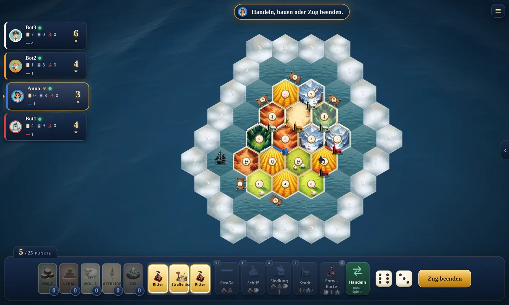
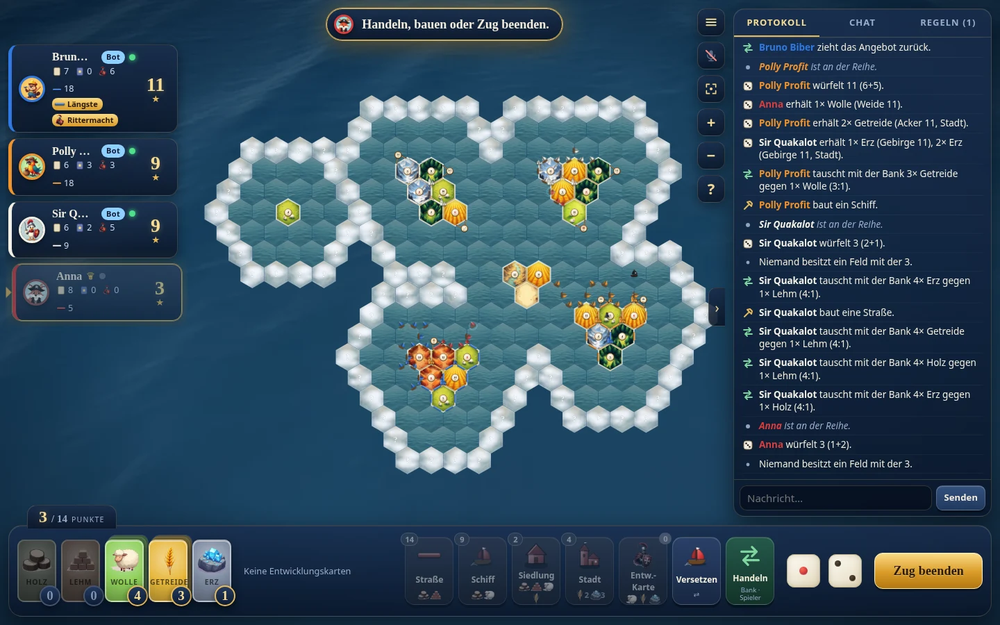
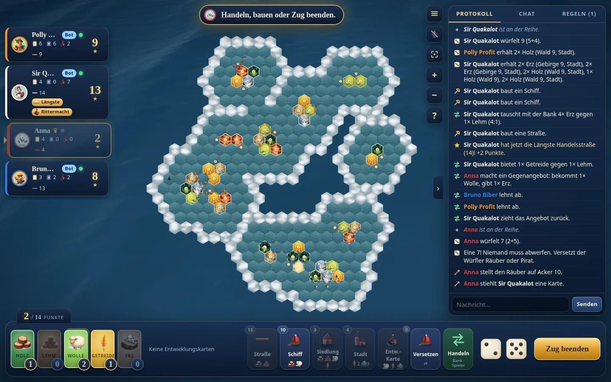
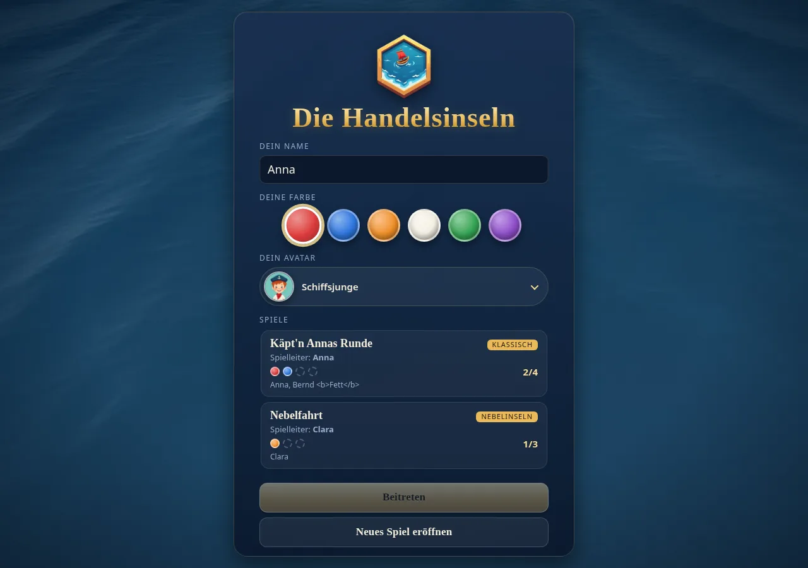
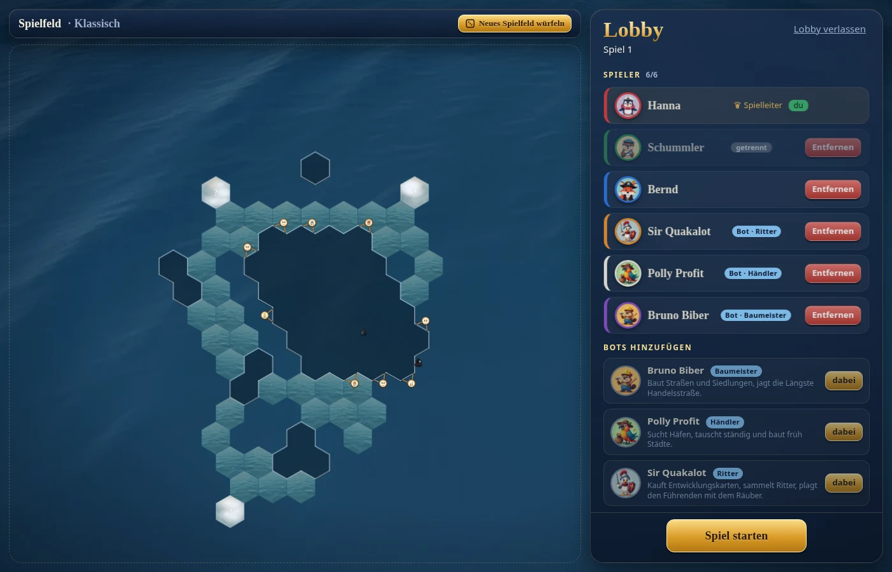
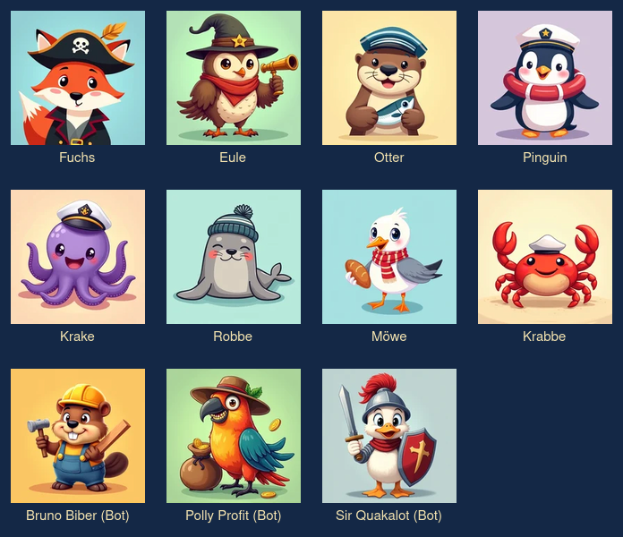
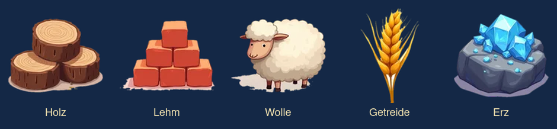
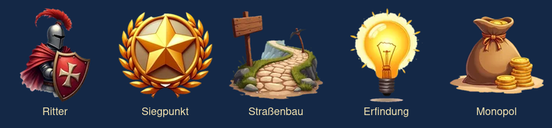
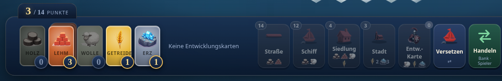
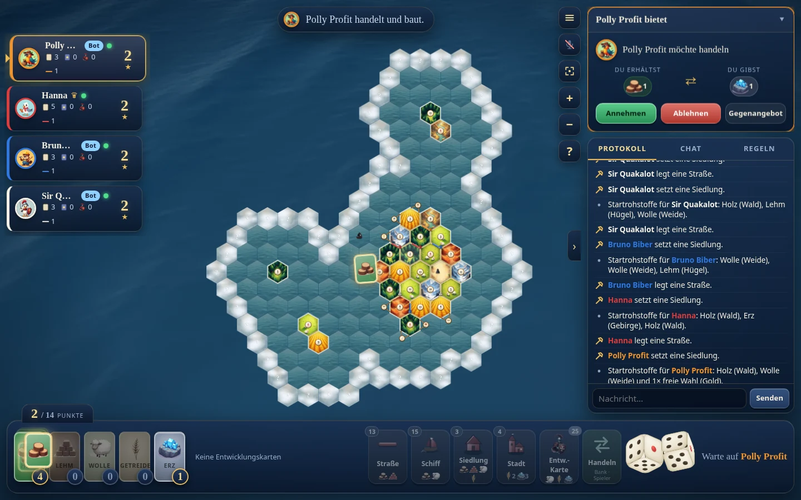

# Die Handelsinseln – Brettspiel im Browser

Mehrspieler-Browserspiel (2–6 Spieler, standardmäßig 14 Siegpunkte). Die gesamte Spiellogik läuft im Server (Podman-Container);
die Mitspieler öffnen nur die Webseite, geben Namen + Farbe an und spielen.

## Screenshots

Echte Partien (Sicht von Anna, dazu die drei Bots), je Variante ein eigenes Spiel:

| Klassisch, Handel offen | Nebelinseln |
|---|---|
|  |  |
| **Vier Heimatinseln** | **Archipel** |
|  |  |


Anmeldung mit Avatar-Auswahl und Lobby mit Bots:

| Anmeldung | Lobby mit Bots |
|---|---|
|  |  |



Die Karten sind mit Flux/Forge gemalt: Rohstoffe, Ereigniskarten (Entwicklungskarten) und die Kartenleiste im Spiel.





Kartenanimation (eine Karte fliegt vom Feld in die eigene Hand):



Neu erzeugen: `node tests/mock/readme.js && node tests/mock/serve.js &` und dann `python3 tests/mock/readme_shots.py`.

## Starten

```bash
podman build -t handelsinseln -f Containerfile .
podman run -d --name handelsinseln -p 8080:8080 -p 8443:8443 -v handelsinseln-data:/data handelsinseln
# Browser: http://<rechner>:8080
```

Dauerbetrieb mit systemd-Quadlet: Vorlage `deploy/handelsinseln.container` (Image `localhost/handelsinseln`, Volume `handelsinseln`, TLS übernimmt ein
Reverse-Proxy, daher `HTTPS_PORT=0`).
Neue Version ausrollen: `podman build -t localhost/handelsinseln:latest . && podman save localhost/handelsinseln:latest | ssh <host> podman load && ssh <host> systemctl restart handelsinseln.service`.

**Handy und App:** Die Oberfläche ist für Handys ausgelegt (kompakte Ansicht, wischbare Kartenleisten, Protokoll als Schublade). Über „Zum Startbildschirm hinzufügen“
bzw. „App installieren“ des Browsers (Manifest + Icons in `public/`, braucht https) läuft das Spiel als eigenständige App. Töne lassen sich im Spielmenü abschalten.

**Release:** Die Version steht in `package.json`. Neue Funktionen kommen in `CHANGELOG.md` unter „Unveröffentlicht“. Zum Veröffentlichen auf `master`:
`./scripts/release.sh 1.0.0 --build` (oder `npm run release -- 1.0.0`) – prüft Branch und sauberen Arbeitsbaum, führt `tests/run_all.sh` aus, setzt Version und CHANGELOG-Abschnitt,
committet „Release 1.0.0“, setzt das Tag `v1.0.0` und baut mit `--build` das Image `localhost/handelsinseln:1.0.0` (+ `latest`). Gepusht wird nie automatisch; das Skript nennt die nächsten Befehle.

Lokal ohne Container: `node server/server.js`. Umgebungsvariablen: `PORT`, `DATA_DIR` (Spielstand), `ABSENT_MS` (Abwesenheit bis Auto-Modus, 60000),
`LISTEN` (Adresse:Port des http-Listeners, z. B. `127.0.0.1:8080`; sonst `PORT`), `MAX_GAMES` (gleichzeitige Spiele, 3), `BOT_MS` (Takt der Bots, 800), `GRACE_MS` (Kulanz, bis ein Spiel ohne verbundenen Menschen endet, 20000), `HTTPS_PORT` (8443), `TLS_CERT`/`TLS_KEY`/`TLS_HOSTS`, `STUN_URL` (optional, für Sprachchat über Netzgrenzen).

**Sprachchat und https:** Browser erlauben das Mikrofon nur unter `https://` oder `http://localhost`. Der Server startet deshalb zusätzlich auf Port 8443 mit https und
erzeugt dafür selbst ein Zertifikat (gespeichert in `DATA_DIR/tls`). Beim ersten Öffnen von `https://<rechner>:8443` muss der Browser-Warnhinweis einmal bestätigt werden
(selbstsigniert); danach meldet man sich dort an. Die Lobby verweist bei `http://` automatisch darauf. Ports: `podman run … -p 8080:8080 -p 8443:8443 …`.
Weitere Namen/IPs für das Zertifikat: `TLS_HOSTS=handelsinseln.lan,192.168.0.20`; eigenes Zertifikat: `TLS_CERT`/`TLS_KEY`; https abschalten: `HTTPS_PORT=0`.
Stummschalten ist immer möglich (Knopf im Spiel und im Menü, optional Push-to-talk mit Leertaste); bei Echo Kopfhörer nutzen.

## Spiele, Lobby, Einstellungen

- Wer den Server betritt, sieht alle beitretbaren Spiele; gibt es keins, eröffnet er ein neues und wird Spielleiter. Beliebig viele Spiele laufen parallel.
- Eine Seitenleiste („Regeln“) listet alle vom Standard abweichenden Einstellungen – in der Lobby und im Spiel.
- Der Spielleiter kann Mitspieler entfernen, die Plätze als „fertig besetzt“ erklären, das Spielfeld vorab ansehen und neu würfeln (die Karten werden auf ausgeglichene Startecken geprüft)
  und wählt die **Variante**: *Klassisch* (Hauptinsel, kleine Inseln, Nebel), *Nebelinseln* (kleine Startinsel, alles muss entdeckt werden),
  *Vier Heimatinseln* (jeder startet auf einer eigenen Insel), *Archipel* (viele kleine Inseln, viel Gold, viele Häfen). Alle in der Lobby sehen die Auswahl live und können per Chat oder Sprache mitreden.
- **Einstellungen** (Standard = Originalregeln): **Auto Ablauf** manuell/auto (Auto: sofort nach Zugende würfeln, Hinweise blenden sich aus, Karten fliegen schnell; Manuell: Reihenfolge wird ausgewürfelt, Hinweise per Klick schließen, Karten fliegen langsam – im Spiel vom Spielleiter über das Menü umschaltbar), Räuber manuell/automatisch, Siegpunkte, Handkarten-Limit (bei einer 7), Bankkurs,
  Spielerhandel an/aus, Inselpunkte, Minima für Längster Handelsweg/Stärkste Schutzmacht und **Vorräte**: Straßen, Schiffe, Siedlungen, Städte, Entwicklungskarten
  (Standard/Zahl/unbegrenzt), Bank-Vorrat je Rohstoff, aufdeckbare Felder je Gelände und Wertechips je Zahl (jeweils Zahl oder unbegrenzt).
  Sind Vorräte des Nebels erschöpft, wird weiter Meer aufgedeckt.
- Der Spielleiter kann das Spiel jederzeit beenden – alle sehen dann eine Statistik (Würfelverteilung, Siegpunktverlauf, Erträge, Handel …).
  Das Spiel endet komplett, wenn der letzte Spieler den Tab schließt oder im Menü „Spiel verlassen“ wählt (≈ 20 s Kulanz für Neuladen).
- **Avatare:** Beim Beitritt wählt jeder eines von 16 Porträts – 8 Tiere und 8 Menschen-Typen (mit Forge/Flux gemalt); vorgeschlagen wird zufällig eines, im gewählten Spiel schon vergebene sind gesperrt.
  Der Server vergibt nie einen Avatar doppelt (bei Kollision bekommt man zufällig einen freien).
- **Bots:** Der Spielleiter kann in der Lobby (Aufklapp-Liste „Bots hinzufügen“ unter den Spielern) bis zu drei Computerspieler hinzufügen, je Sorte einen, mit festem Avatar und Namen:
  *Bruno Biber* (Baumeister – baut Straßen und Siedlungen, jagt den Längsten Handelsweg), *Polly Profit* (Händler – Häfen, viel Tauschen, früh Städte)
  und *Sir Quakalot* (Ritter – Entwicklungskarten, Schutzmacht, stört den Führenden mit dem Räuber). Menschen können die Bot-Avatare und -Namen nicht wählen.
  Bots nutzen nur öffentliche Informationen und ziehen im Takt (`BOT_MS`, Standard 800 ms). Der Spielleiter kann sie vor Spielbeginn wieder entfernen.
- **Kartenanimation:** Karten fliegen von der Quelle (Feld, Bank, Spieler) zum Ziel, jede leicht versetzt. Deine eigenen Karten sind groß und golden umrandet, Bewegungen anderer klein; gestohlene oder abgeworfene Karten unter anderen sind verdeckt.
- **Auto-Modus** für Verlassene und länger Abwesende (> 60 s): Sie erhalten weiter Erträge, nehmen jedes 1:1-Angebot an, werfen/wählen zufällig,
  setzen den Räuber zufällig und beenden ihren Zug. Wer das Spiel *verlassen* hat, dessen Infrastruktur kann ein angrenzender Mitspieler **übernehmen**
  (je Zug *ein* Teil, anstelle eines Schiffsversetzens) – oder sie *verschwindet* nach einer einstellbaren Zahl von Runden (Wahl beim Spielstart).
  Abwesende, die zurückkehren, spielen wieder selbst.

## Tests

```bash
node tests/rules.js      # gezielte Regeltests (Basisspiel + Erweiterung)
node tests/features.js   # Einstellungen, Varianten, Vorräte, Auto-Modi, Übernahme, Statistik, Spieleverwaltung
node tests/sim.js 6      # Testspieler spielen vollständige Partien (2–6 Spieler), Invarianten werden geprüft
node tests/e2e.js        # echtes HTTP/SSE: parallele Spiele, Verlassen, Tab schließen, Signalweg, ganze Partien
python3 tests/browser_lobby.py       # drei echte Browser: Lobby, Variante, Entfernen, Verlassen, Beenden, Statistik
python3 tests/browser_play.py 4 120 [auto]  # Browser-Spieler klickt Aufbau, Würfeln, Bauen, Handeln selbst
python3 tests/browser_soak.py 6 90   # echte Browser sehen eine ganze Partie, Konsolenfehler werden geprüft
python3 tests/browser_voice.py       # Sprachchat (WebRTC) mit Fake-Mikrofon gegen den echten Server
python3 tests/browser_fx.py          # Kartenanimation: Karten fliegen versetzt vom Feld/der Bank zu den Spielern, nichts wird nachgespielt
python3 tests/browser_bots.py        # Avatar-Auswahl (nie doppelt) und Bots in Lobby und Spiel in echten Browsern
node tests/bots.js 8                 # Bot-Turnier: Baumeister/Händler/Ritter gegen Zufallsspieler und untereinander (Siege, Hänger)
python3 tests/browser_takeover.py    # Übernahme der Infrastruktur eines Verlassenen in der echten Oberfläche
python3 tests/browser_lobby_preview.py  # Gäste sehen die Brettvorschau des Spielleiters, Nebelring, abweichende Regeln
python3 tests/browser_https_voice.py    # Mikrofon im LAN: Hinweis auf http, Sprachverbindung über das erzeugte https-Zertifikat
tests/run_all.sh                        # alles nacheinander
```

## Regeln (Quellen: offizielle Regel 2015, 5-6-Spieler-Erweiterung)

Basisspiel wie gewohnt (Aufbau in Schlangenreihenfolge, Würfeln, Handel, Räuber, Entwicklungskarten,
Längster Handelsweg ab 5, Stärkste Schutzmacht ab 3 Rittern) plus:

- **Schiffe** (Wolle + Holz): nur auf Meer-/Küstenkanten, verbinden sich mit Straßen nur über eigene Siedlungen.
  Pro Zug darf ein *offenes* Schiff (mind. ein freies Ende, nicht in diesem Zug gebaut) versetzt werden.
- **Pirat**: bei einer 7 oder durch Ritter statt des Räubers aufs Meer; stiehlt von Schiffsbesitzern und sperrt Schiffsbau/-bewegung an seinem Feld.
- **Goldfelder**: Ertrag nach freier Wahl. **Häfen** 3:1 und 2:1.
- **Entdeckung**: Das Spielfeld ist zufällig und unbegrenzt. Wer mit Straße oder Schiff an ein unentdecktes Feld stößt, deckt es auf;
  Land bringt 1 Rohstoff Belohnung (Gold: freie Wahl), Meer nichts.
- **Neue Inseln**: Die erste Siedlung auf einer neuen Insel bringt Sonderpunkte (Standard 2, höchstens für zwei Inseln pro Spieler).
- **Straßenbau-Karte** erlaubt Straßen und/oder Schiffe.
- Ab 5 Spielern: **Sonderbauphase** nach jedem Zug (bauen/kaufen, kein Handel mit Spielern); Spieler ohne Möglichkeit werden übersprungen.
- Bank-Vorrat standardmäßig unbegrenzt; bei gesetztem Vorrat gilt die Originalregel (reicht er nicht, bekommt ein einzelner Empfänger den Rest, mehrere niemanden).

Grafik: Die gemalten Geländetexturen, Spielsteine (Siedlung, Stadt, Räuber, Piratenschiff) und Hafenstege (`public/img/`) wurden mit Flux über einen Forge-Server erzeugt (je Motiv mehrere Entwürfe, der schönste gewählt).
Protokoll Client ⇄ Server: `PROTOKOLL.md`.
