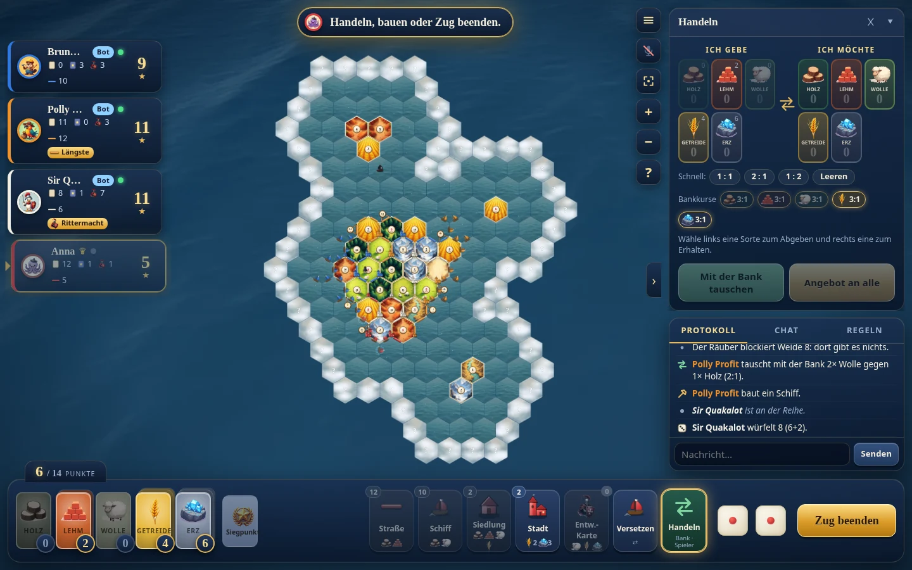
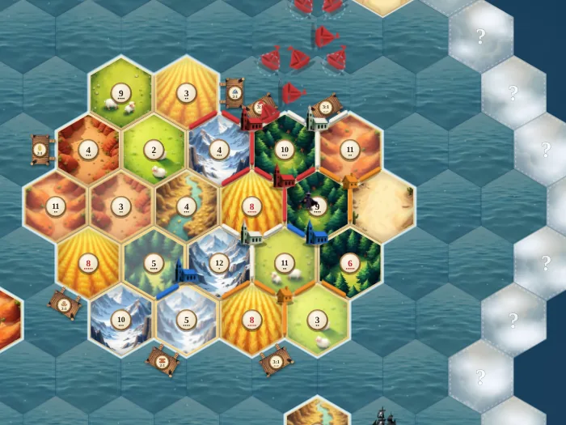
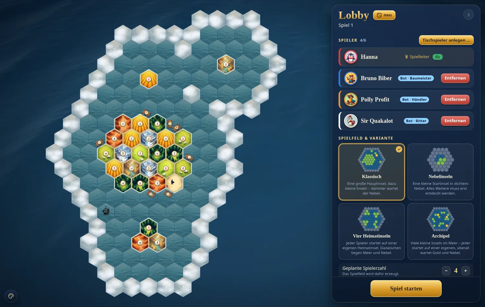
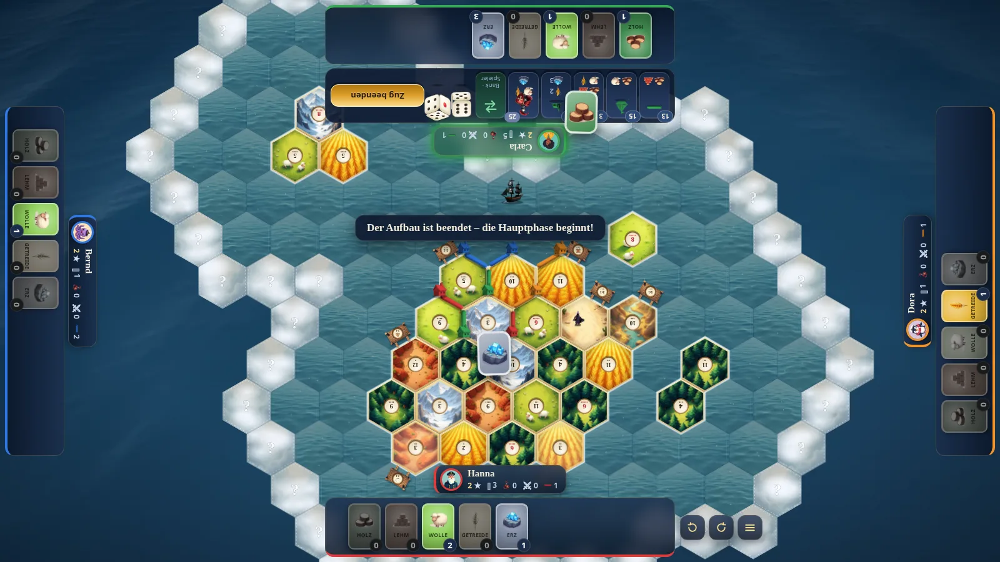
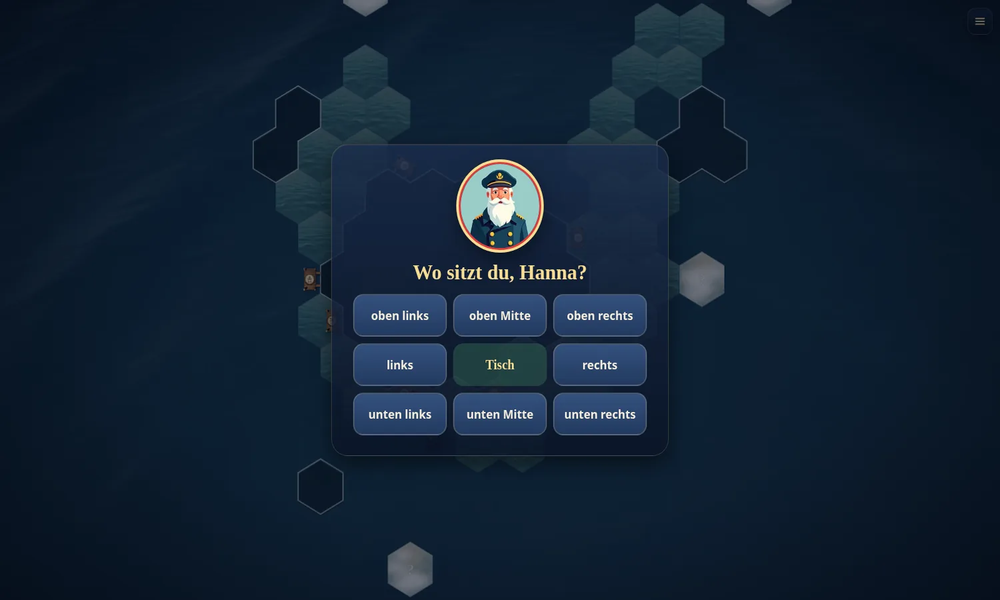
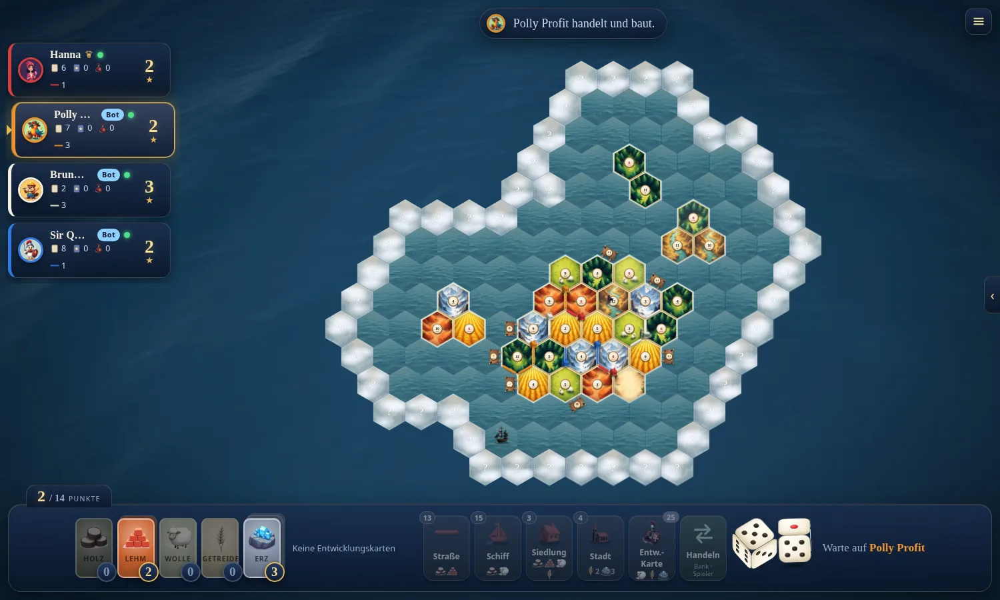
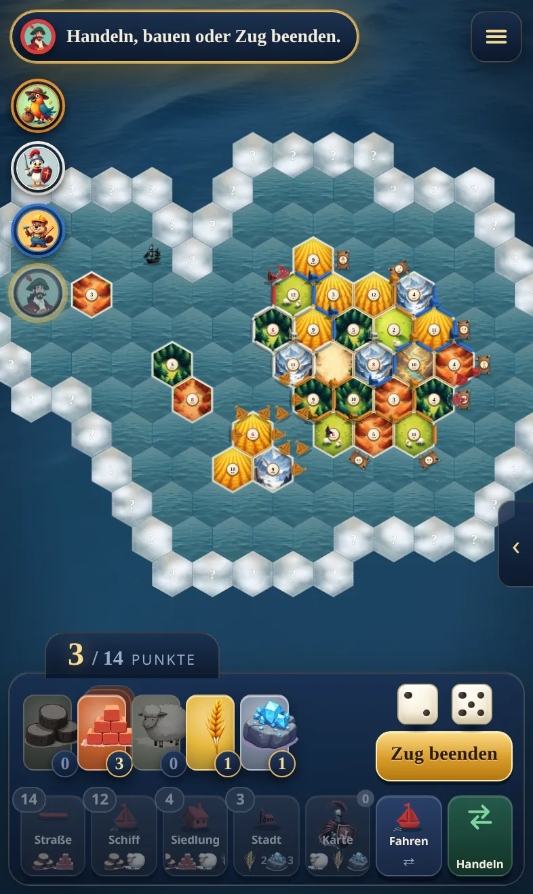
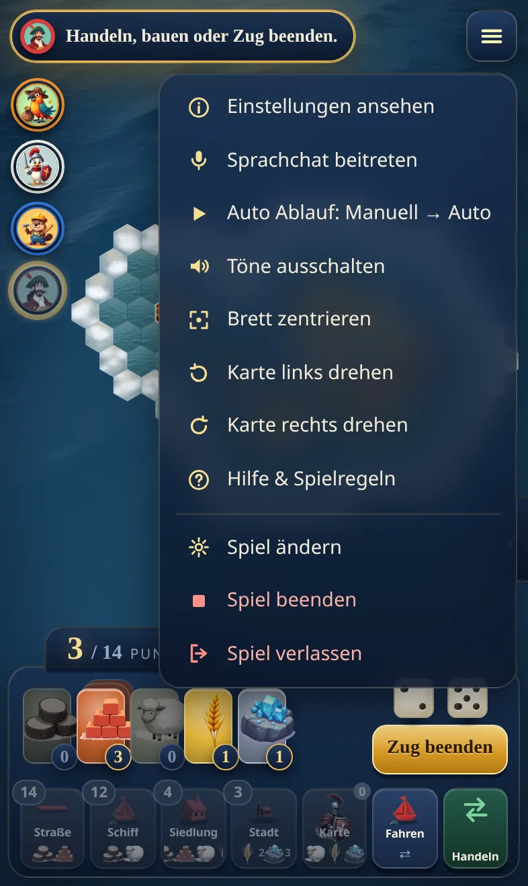
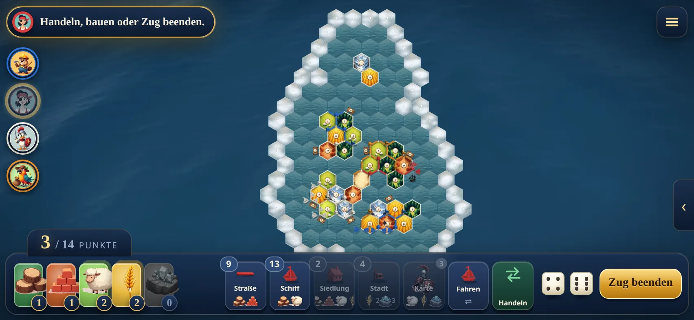
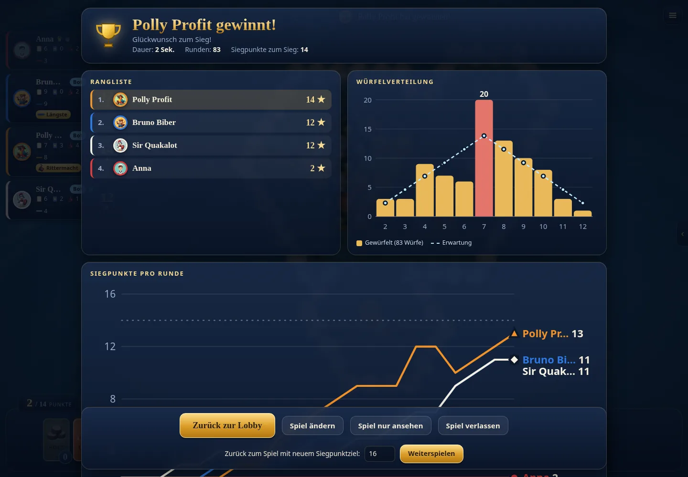

<p align="center">
  
</p>

<h1 align="center">Die Handelsinseln</h1>

<p align="center"><strong>Siedlungen bauen. Inseln entdecken. Handeln. Gewinnen.</strong><br>
Ein Mehrspieler-Brettspiel im Browser für 2–6 Spieler – ohne Konto, ohne Installation,<br>
am PC, am Tablet, am Handy oder gemeinsam an einem digitalen Spieltisch.</p>

<p align="center">
  <em>4 Kartenwelten · Bots mit Persönlichkeit · Sprachchat · Zuschauer · PWA</em><br>
  <strong>Der ganze Server: ein einziges Binary unter 5 MB.</strong> Kein Node, kein Python, keine Datenbank – statisch gelinkter
  Rust-Server im Container ohne Shell. Auf einem Raspberry Pi genauso zu Hause wie auf dem Heimserver.
</p>

---

## Das Spiel

Ihr baut eure erste Siedlung auf einer unbekannten Inselwelt. Sammelt Holz, Lehm, Wolle, Getreide und Erz, baut Straßen, Siedlungen und Städte,
handelt mit der Bank oder untereinander – und entdeckt mit euren Schiffen, was jenseits des Nebels liegt. Wer zuerst die vereinbarte
Siegpunktzahl erreicht (standardmäßig 14), gewinnt.

- **Vier Kartenwelten:** *Klassisch* mit großer Hauptinsel, *Nebelinseln*, in denen fast alles entdeckt werden muss, *Vier Heimatinseln*
  für getrennte Startinseln und *Archipel* mit vielen kleinen Inseln, Gold und Häfen.
- **Entdecken statt abmalen:** Die Karte wird bei jedem Spiel neu erzeugt. Der Nebel ist unbegrenzt – wer an seine Grenze baut,
  deckt das nächste Feld auf. Land bringt eine Belohnung, Meer nicht.
- **Schiffe, Piraten, Gold:** Schiffe verbinden Küsten, der Pirat blockiert Seewege und stiehlt von Schiffsbesitzern; Goldfelder
  liefern Rohstoffe nach freier Wahl.
- **Handel mit Charakter:** Bankkurse, 3:1- und 2:1-Häfen, Angebote an alle, Gegenangebote und Bestätigung – alles in der Oberfläche.
- **Bots, Auto-Modus, Übernahme:** Bruno Biber, Polly Profit und Sir Quakalot spielen mit eigenen Strategien. Wer kurz weg ist,
  wird automatisch vertreten; wer das Spiel verlässt, dessen Infrastruktur kann übernommen werden oder verschwindet.
- **Mehr als ein Spielbrett:** digitaler Spieltisch, Zuschaueransicht, Gerätekopplung an ein Handy, Sprachchat, Statistik nach
  Spielende und eine installierbare App (PWA) für Android und iPhone.

## Vier Welten, ein Ziel

| Nebelinseln | Vier Heimatinseln | Archipel |
|---|---|---|
|  |  |  |

Jede Variante hat eigene Startbedingungen – die Lobby zeigt sie live, alle Mitspieler sehen die Auswahl.

<p align="center">
  
</p>

Aus der Nähe: gemalte Landschaften, Werte-Chips, Siedlungen, Straßen und Schiffe – jedes Feld ein kleines Bild.

## Ein Blick hinein

**Lobby:** Name, Farbe und Avatar wählen (28 Porträts, nie doppelt), Bots dazuholen, Variante und Regeln einstellen – dann
„Spiel starten“. Name und Avatar werden beim ersten Beitritt festgelegt; die Farbe bleibt als Standard, bis ein anderer
Mensch sie belegt – dann weicht zuerst ein Bot auf eine freie Farbe aus. Der Hintergrund lässt sich pro Gerät wählen:
Meer, Seekarte, Nebelmeer, Holz oder Pergament. Der Spielleiter kann der Partie außerdem im Lobby-Kopf einen eigenen
Namen geben; er erscheint sofort in der Spieleliste auf der Anmeldung.



**Digitaler Spieltisch:** Der Bildschirm des Spielleiters wird zur Tischplatte – mit vorab angelegten Tischspielern oder über
„Spieltisch anbieten“ mitten in der Partie. Die Leisten sitzen gedreht am Rand, Handelsangebote erscheinen beim jeweiligen Spieler.
Online-Spieler und Bots lassen sich dazumischen.



| Platzwahl beim Start | Partie im Spiel |
|---|---|
|  |  |

**Auf dem Handy:** kompakte Leiste, alle fünf Rohstoffe, Bestätigung per Fingertipp – hochkant und quer.

| Spiel | Spielmenü |
|---|---|
|  |  |



Die Karte lässt sich mit einem Finger verschieben und mit zwei zoomen; das Menü dreht sie in 60°-Schritten. Ziele werden per
Fingertipp markiert und erst mit dem Bestätigungsknopf ausgeführt. Über „Zum Home-Bildschirm“ (iPhone) bzw. „App installieren“
(Android) läuft das Spiel als PWA ohne Adressleiste; Töne lassen sich im Menü abschalten.

**Nach dem Spiel:** Punkteverlauf, Erträge, Handel, Bauten – die ganze Partie in Zahlen.



<details>
<summary><strong>Screenshots erneuern</strong></summary>

Die Bilder stammen aus echten Partien gegen den Rust-Server. Die Browser-Tests legen ihre Aufnahmen unter `$SHOTS` ab
(z. B. `SHOTS=/tmp/shots python3 tests/browser_play.py 4 40`, `tests/browser_table.py`, `tests/browser_mobile.py`);
die vier Kartenwelten und die Detailvergrößerung der Felder liefert `tests/browser_welten.py`. Mit
`cwebp -q 82 bild.png -o docs/screenshots/name.webp` werden daraus die WebP-Dateien.

</details>

<details>
<summary><strong>Spieltisch, Controller, Kopplung und Zuschauer – so bedient man sie</strong></summary>

- **Tischspieler anlegen:** In der Lobby „Tischspieler anlegen …“ wählen (Name, Farbe, Avatar). Der Browser des Spielleiters wird
  zur Tischplatte; beim Start wählt jeder Tischspieler der Reihe nach einen von acht Plätzen. Die Leisten sitzen gedreht am Rand,
  Handelsangebote erscheinen beim jeweiligen Spieler. Online-Spieler und Bots lassen sich dazumischen.
- **Spieltisch anbieten:** Im Spiel oder in der Lobby bietet der Spielleiter den Tisch über das Menü an – der Eintrag erscheint nur
  auf Bildschirmen ab FullHD. Jeder Mitspieler entscheidet auf seinem Gerät; wer annimmt, wählt seinen Platz. Danach wird der
  Bildschirm des Spielleiters zur Tischplatte, die angenommenen Geräte wechseln in die Controller-Ansicht. Ablehnende und Bots
  spielen normal weiter und sitzen am Tisch nur öffentlich. Passt ein Wunschplatz nicht zur festen Zugreihenfolge, erscheint eine
  erneute Auswahl mit den möglichen Plätzen.
- **Zuschauen:** Auf der Startseite ein laufendes Spiel wählen („Spiel ansehen“). Die öffentliche Tischansicht zeigt alle Leisten,
  Würfel und Meldungen – ohne Handkarten, Chat oder Aktionen; bis zu 8 Zuschauer je Spiel.
- **Controller-Ansicht:** Sieht ein Handy dem Tisch zu, schaltet es von selbst auf Karten und Aktionen um. Eine Aktion am Spielfeld
  wird erst am Handy freigegeben; der Tisch zeigt die möglichen Ziele, die Bestätigung erfolgt am Handy. So kann niemand für den
  Spieler am Zug handeln. Rückfragen (Abwerfen, Gold, Opfer, Handel) bleiben am Handy.
- **Platz auf ein Handy koppeln:** Am Tisch auf das ▦ in der Leiste eines Platzes tippen; der Spieltisch zeigt einen QR-Code, das
  Handy scannt ihn. Danach spielt das Handy an diesem Platz; ein Bot wird dabei zum menschlichen Spieler. Die Kopplung ersetzt die
  frühere Kontrollübergabe.
- **Auto-Modus:** Wer länger als eine Minute weg ist, wird automatisch vertreten: Erträge laufen weiter, 1:1-Angebote werden
  angenommen, gewürfelt und entschieden wird zufällig. Wer zurückkommt, spielt wieder selbst. Verlassene Infrastruktur kann ein
  angrenzender Mitspieler übernehmen oder – je nach Einstellung – nach einigen Runden verschwinden.
- **Kartenanimation:** Karten fliegen von der Quelle (Feld, Bank, Spieler) zum Ziel. Eigene Karten sind groß und golden umrandet,
  Bewegungen anderer klein; gestohlene oder abgeworfene Karten bleiben verdeckt. Der Spielleiter kann die Partie jederzeit beenden;
  alle sehen danach die Statistik.

</details>

## So spielt es sich

1. **Aufbau:** Jeder setzt zwei Siedlungen und zwei Straßen (oder Schiffe) – in Schlangenreihenfolge. Die zweite Siedlung bringt
   Startrohstoffe.
2. **Zug:** Würfeln, Erträge kassieren, bauen, handeln, Entwicklungskarte spielen, Zug beenden. Eine 7 bringt den Räuber (oder
   den Piraten) und lässt Spieler mit mehr als sieben Karten abwerfen.
3. **Bauen:** Straße/Schiff (Holz + Lehm bzw. Holz + Wolle), Siedlung (Holz, Lehm, Wolle, Getreide), Stadt (zwei Getreide, drei Erz),
   Entwicklungskarte (Wolle, Getreide, Erz).
4. **Punkte:** Siedlung 1, Stadt 2, Inselbonus, Längster Handelsweg (ab 5) und Stärkste Schutzmacht (ab 3 Rittern) je 2,
   Siegpunktkarten 1. Bei 14 Punkten ist Schluss – verdeckte Siegpunktkarten zählen mit.
5. **Besonderheiten:** Schiffe dürfen nur an Küsten und verbinden sich mit Straßen nur über eigene Siedlungen; pro Zug darf ein
   offenes Schiff versetzt werden. Die Straßenbau-Karte erlaubt Straßen und Schiffe. Ab fünf Spielern gibt es nach jedem Zug eine
   Sonderbauphase: Wer die Rohstoffe sofort hat, baut reihum; alle anderen werden übersprungen. Gehandelt wird dort nicht, auch
   nicht mit der Bank.

## Geräte und Wiederfinden

- **Auf dem Handy weiterspielen:** In der Lobby „Handy koppeln“ wählen, am Spieltisch das ▦ in der Leiste eines Platzes. Das
  andere Gerät scannt den QR-Code mit der Kamera. Der Code gilt 60 Sekunden und nur einmal; der Sitzungsschlüssel selbst steht
  nie im QR-Code.
- **Partien wiederfinden:** Im Hintergrund legt der Browser einen Spielerpass aus vier Wörtern an; sichtbar wird er erst
  mit dem ersten Spiel, wenn Name, Avatar und Farbe an ihn gebunden werden. Bis dahin steht auf der Anmeldung nur „Ich
  habe einen Spielerpass“ bereit, um einen vorhandenen Pass einzugeben. Mit dem Pass erscheinen unter „Meine Partien“ alle
  laufenden und beendeten Partien – auch auf einem neuen Gerät oder nach dem Löschen der Browserdaten. Laufende Partien mit
  eigenem Platz zeigt die Startseite direkt als „Fortsetzen“; pausierte Partien erreichst du weiterhin über „Meine Partien“. Ist der Pass
  gebunden, steht auf der Anmeldung und in den Passansichten oben ein Kopf mit Avatar, Name, „Spielerpass aktiv“ und Farbe;
  darunter führen „Meine Partien“ und „Mein Spielerpass“ weiter. Die Farbpalette erscheint nur, wenn ein anderer Mensch die
  Farbe belegt. Der Pass bleibt auf dem Gerät; an den Server geht nur eine daraus abgeleitete, servergebundene Kennung.
  Behandle die Wörter wie ein Passwort und notiere sie dir, bevor du eine Partie pausierst: Verliert der Browser seine
  Daten, kommt sonst niemand mehr an die Partie. Ein Pass samt seinen Partien wird nach 30 Tagen ohne Zugriff gelöscht.
  Wird der Pass gelöscht, sind Name, Avatar und Farbe wieder frei wählbar; der nächste Beitritt erzeugt einen neuen Pass.
- **Pausieren:** Verlässt der letzte Mensch eine laufende Partie und haben alle menschlichen Mitspieler einen Spielerpass,
  wird sie pausiert (bis zu 30 Tage) statt abgeräumt und lässt sich unter „Meine Partien“ fortsetzen. Fehlt einem
  Mitspieler der Pass, wird die Partie wie bisher abgeräumt. Beim Verlassen erinnert die Rückfrage daran, den Pass zu
  notieren.

## Spielen

### Mit Container (empfohlen)

```bash
podman build -t handelsinseln .
podman run -d --name handelsinseln -p 8080:8080 -p 8443:8443 \
  -v handelsinseln-data:/data handelsinseln
# Browser: http://<rechner>:8080
# https (für Sprachchat): https://<rechner>:8443 – Zertifikatswarnung einmal bestätigen
```

Fertiges Multi-Arch-Image (amd64/arm64) aus GHCR:

```bash
podman run -d --name handelsinseln -p 8080:8080 -p 8443:8443 \
  -v handelsinseln-data:/data ghcr.io/hgruber/handelsinseln:latest
```

Das Paket ist standardmäßig privat: entweder in den GitHub-Paketeinstellungen öffentlich machen oder auf dem Server
`podman login ghcr.io` mit einem PAT (`read:packages`) ausführen.

Der Server ist ein statisch gelinktes Rust-Binary im `scratch`-Container: rund **4,9 MB**, keine Shell, keine Laufzeit-Abhängigkeiten.
TLS ist eingebaut: Ohne weitere Angabe lauscht er zusätzlich auf 8443 mit einem selbstsignierten Zertifikat. Namen und IP-Adressen für
das Zertifikat kommen aus `TLS_HOSTS` (z. B. `-e TLS_HOSTS=handelsinseln.lan,<LAN-Adresse>`). Hinter einem Reverse-Proxy
`-e HTTPS_PORT=0` setzen und nur 8080 veröffentlichen.

### Auf dem Raspberry Pi 64-bit

```bash
# nativ auf dem Pi (empfohlen):
podman build -f Containerfile.pi -t localhost/handelsinseln:latest .
podman run -d --name handelsinseln -p 8080:8080 -p 8443:8443 \
  -v handelsinseln-data:/data localhost/handelsinseln:latest
```

`Containerfile.pi` baut ein aarch64-Image. Auf einem x86_64-Rechner geht es mit qemu-user-static (langsam):

```bash
podman build --platform linux/arm64 -f Containerfile.pi -t localhost/handelsinseln:pi .
```

### Ohne Container

```bash
cargo build --release --locked --manifest-path rust/Cargo.toml
./rust/target/release/handelsinseln
```

Zum Entwickeln: `PORT=8090 HTTPS_PORT=0 DATA_DIR=/tmp/handelsinseln-dev ./rust/target/release/handelsinseln` (nur http).
Änderungen in `public/` genügt ein Neuladen im Browser (ggf. „Bypass for network“ für den Service Worker); Rust-Änderungen
brauchen einen Neustart.

### Dauerbetrieb

Die Quadlet-Vorlage `deploy/handelsinseln.container` läuft unter systemd/podman mit Volume und `HTTPS_PORT=0` hinter einem
Reverse-Proxy. Sie nutzt `ghcr.io/hgruber/handelsinseln:latest` mit `AutoUpdate=registry`; den Auto-Update-Timer aktivierst
du mit `systemctl enable --now podman-auto-update.timer` (GHCR-Paket öffentlich oder `podman login ghcr.io`). Der Spielstand liegt in `DATA_DIR/state.json`, abgeschlossene Partien hängen als JSON-Zeile an `DATA_DIR/partien.jsonl`.
Das Betriebslog geht nach stdout (eine Zeile je Ereignis; Rotation übernimmt journald). Unter systemd/Quadlet `LOG_TIMESTAMP=0` setzen,
dann schreibt nur journald den Zeitstempel.

## Sprachchat und https

Browser erlauben das Mikrofon nur unter `https://` oder `http://localhost`. Der Server startet deshalb zusätzlich auf 8443 mit https
und erzeugt dafür selbst ein Zertifikat (`DATA_DIR/tls/tls.json`; Namen und IPs aus `TLS_HOSTS`). Beim ersten Öffnen die Warnung
einmal bestätigen, danach dort anmelden. Eigenes Zertifikat: `TLS_CERT`/`TLS_KEY`; https abschalten: `HTTPS_PORT=0`.
Stummschalten ist immer möglich (Knopf im Spiel und im Menü, optional Push-to-talk mit Leertaste); bei Echo Kopfhörer nutzen.

## Einstellungen

Standard ist die klassische Regel. In der Lobby (Seitenleiste „Regeln“) und im laufenden Spiel („Spiel ändern“) lassen sich unter
anderem einstellen: Auto-Ablauf (manuell/automatisch), Variante, Räuber manuell/automatisch, Siegpunkte, Handkartenlimit, Bankkurs,
Spielerhandel, Inselpunkte, Minima für Längster Handelsweg und Stärkste Schutzmacht, Vorräte (Straßen, Schiffe, Siedlungen, Städte,
Bank, aufdeckbare Felder, Wertechips), Entwicklungskarten je Art sowie die Hausregel Stadtmauer.

<details>
<summary><strong>Wichtige Umgebungsvariablen</strong></summary>

| Variable | Standard | Bedeutung |
|---|---|---|
| `PORT` | `8080` | HTTP-Port |
| `LISTEN` | – | Adresse:Port des HTTP-Listeners (z. B. `127.0.0.1:8080`); sonst `PORT` |
| `DATA_DIR` | `data` | Spielstand, Zertifikat, Partienberichte |
| `MAX_GAMES` | `3` | gleichzeitige Spiele |
| `HTTPS_PORT` | `8443` | HTTPS-Port; `0` = aus |
| `TLS_HOSTS` | – | Namen/IPs für das selbstsignierte Zertifikat |
| `TLS_CERT`, `TLS_KEY` | – | eigenes Zertifikat/Schlüssel (PEM) |
| `STUN_URL` | – | optional, für Sprachchat über Netzgrenzen |
| `RNG_SEED` | – | fester Zufallsstrom für reproduzierbare Partien |
| `ABSENT_MS` | `60000` | Abwesenheit bis Auto-Modus |
| `BOT_MS` | `800` | Takt der Bots |
| `TICK_MS` | `2000` | Takt der Zeitprüfung |
| `GRACE_MS` | `20000` | Kulanz, bis ein Spiel ohne verbundenen Menschen endet |
| `PAUSE_MS` | `2592000000` | Aufbewahrung einer pausierten Partie (30 Tage) |
| `PASS_MS` | `2592000000` | Aufbewahrung eines Spielerpasses nach dem letzten Zugriff (30 Tage) |
| `PASS_MIN_MS` | `86400000` | Mindestalter eines Passes vor dem Abräumen (24 h) |
| `PAIR_MS` | `60000` | Gültigkeit eines Kopplungscodes |
| `SSE_PING_MS` | `20000` | Lebenszeichen im Ereignisstrom |
| `LOG_LEVEL` | `info` | `error`/`warn`/`info`/`debug`/`silent` |
| `LOG_TIMESTAMP` | `1` | `0`/`off` schaltet den Zeitstempel im Server-Log ab |
| `APP_VERSION` | – | Versionszusatz im Client (`git describe`-Format, z. B. `v1.0.0-5-g11661da`; Build-Arg des Containers) |

</details>

## Technik

- **Server:** Rust, ein statisch gelinktes Binary, `scratch`-Container, rund 4,9 MB. Kein Node, kein Python, keine Datenbank zur Laufzeit.
- **Client:** Vanilla JavaScript ohne Build-Schritt und ohne Framework; SVG-Brett mit Diff-Rendering, Service Worker/PWA.
- **Protokoll:** HTTP/1.1, Server-Sent Events für den Spielzustand, JSON-Aktionen über `POST /api/act`. Der Zustand ist serde-JSON und
  damit speicherbar; die Spiellogik liegt vollständig im Server, der Client rendert nur die Sicht.
- **Sicherheit:** Der Server liefert keine fremden Handkarten; die Zuschauer- und Tischansicht ist öffentlich. TLS mit selbstsigniertem
  Zertifikat oder eigenen PEM-Dateien. Das Betriebslog enthält keine IP-Adressen oder Tokens.
- **Tests:** Die Spielregeln sind mit gezielten Rust-Unit-Tests auf handgebauten Brettern abgedeckt; dazu kommen HTTP-/SSE-/TLS-Tests
  und Browser-Tests mit Playwright.

## Tests

Die Tests laufen ausschließlich gegen den Rust-Server. Voraussetzungen: eine Rust-Toolchain; für die Testskripte Node ≥ 20 und ESLint;
für die Browser-Tests Python 3 + Playwright mit Chromium (`pip install -r requirements.txt && python3 -m playwright install chromium`).

```bash
# Rust-Regeltests: handgebaute Bretter, Züge, Handel, Räuber, Punkte, Aufbau, Lobby, JSON-Roundtrip
cargo test --release --locked --manifest-path rust/Cargo.toml --test rules

bash tests/run_all.sh schnell   # Unit-, API- und TLS-Tests (ohne Browser)
bash tests/run_all.sh           # volle Suite mit echten Browsern
```

Die 26 Regeltests brauchen rund 0,05 s Laufzeit (ohne die einmalige Kompilierung). Die schnelle Stufe ist nach jeder Änderung
empfohlen; die volle Suite startet die Browser-Tests parallel und legt Logs und Screenshots unter `$SHOTS` ab.
Auf GitHub laufen beide Stufen automatisch (`.github/workflows/tests.yml`), nachts zusätzlich lange Spiel-Dauerläufe.

## Dokumentation

- `PROTOKOLL.md` – Wire-Protokoll zwischen Client und Server
- `docs/rust-server.md` – Aufbau und Besonderheiten des Rust-Servers
- `CHANGELOG.md` – Änderungshistorie
- `BACKLOG.md` – offene Ideen
- `CLAUDE.md` – Hinweise für die Entwicklung im Repository

## Lizenz

MIT, siehe `LICENSE`.
